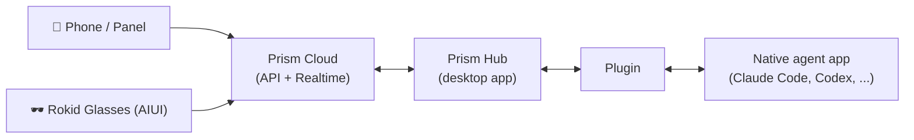

# 中文

**[English](#what-is-prism)** / **中文**

## Prism 是什么？

Prism 让你能从手机等移动设备连接桌面端Agent。让 Codex、Hermes 或 OpenClaw 在你的 Mac 或 PC 上持续工作，然后拿起手机、或戴上 Rokid 眼镜，随时随地查看进度、继续对话、处理审批，或发起新任务。

Prism-Rokid 组织托管这个生态的开源部分：**PluginBridge SDK**（本仓库）与连接 Prism 和本地智能体的**官方插件**。

**命名灵感**：像棱镜分光一样，将你的任务散射链接到各个智能体。而智能体就像光谱里的频段一样，可以通过插件的形式支持无限多。

## 产品功能

- **全局可见** — Agent → 项目 → 线程三层视图，在线 / 工作中状态一目了然，还有 token 用量、剩余额度、连续使用天数等用量统计
- **远程继续对话** — 发送消息与附件，完整对话流实时渲染，支持 Markdown、工具调用与逐步执行进度
- **掌控全局** — 切换模型、推理强度与权限模式，随时中断正在运行的任务
- **审批与规划** — 处理权限审批、管理排队消息、以计划模式运行智能体、设置或暂停目标
- **及时通知** — 审批请求与任务完成的 Web Push 提醒
- **多语言** — English、简体中文、日本語

## 两种使用方式

- **Prism Panel（PWA）** — 在手机或桌面浏览器打开 <https://prism-panel.rokid.com>，即可添加到主屏幕。一次安装，随处管理远程任务。
- **Rokid Glasses AIUI** — 推荐搭配 Rokid 眼镜使用。通过眼镜随时随地进行远程任务协作，解放双手。

## 工作原理

你的设备与 Prism 云端通信，云端与运行在桌面上的 Prism Hub 通信，Hub 再通过插件驱动各个智能体。云端与桌面端随 Prism 产品发布——**本组织开源并维护的是插件层**。

## prism-rokid 组织

| 仓库 | 作用 |
| --- | --- |
| **prism-plugin-sdk**（本仓库） | 构建插件的 PluginBridge SDK，以三种语言发布：Go module（`github.com/prism-rokid/prism-plugin-sdk`）、npm 包（`@prism-rokid/pluginbridge-plugin-sdk`）、PyPI 包（`rokid-pluginbridge-plugin-sdk`）。同时定义插件 manifest 规范与一致性测试套件。 |
| [prism-plugin-claude-code](https://github.com/prism-rokid/prism-plugin-claude-code) | Claude Code 官方插件 — 协议原生，通过 ACP 对接本地 `claude` 运行时 |
| [prism-plugin-codex](https://github.com/prism-rokid/prism-plugin-codex) | Codex 官方插件 — 通过桌面自动化操作 Codex Desktop，浏览会话、读取历史、继续线程 |
| [prism-plugin-hermes](https://github.com/prism-rokid/prism-plugin-hermes) | Hermes 官方插件 — 通过 Hermes 网关实现远程会话 |
| [prism-plugin-openclaw](https://github.com/prism-rokid/prism-plugin-openclaw) | OpenClaw 官方插件 — 协议原生，对接 OpenClaw 网关 |

插件以两种方式之一接入智能体：**协议原生**通过智能体自身的协议（API、RPC 或 CLI）通信；**桌面自动化**在没有开放协议时操作智能体的桌面应用。插件以 GitHub Releases 分发，Hub 会自动发现、安装并更新它们。

## SDK 简介

PluginBridge SDK 提供 Go、TypeScript/Node.js、Python 三种语言开发 Prism 插件所需的一切。一个插件是由 `pluginbridge-plugin.yaml` manifest 描述的小程序：Prism Hub 启动它，并通过 JSON-lines stdio 以 PluginBridge v4 协议通信。三种语言的 SDK 都提供相同的 `serve` 入口——你用各语言的原生类型实现处理函数，SDK 负责转换为锁定的 snake_case 线协议。

| 语言 | 包 | 安装 |
| --- | --- | --- |
| Go | `github.com/prism-rokid/prism-plugin-sdk` | `go get github.com/prism-rokid/prism-plugin-sdk@v0.1.1` |
| Node.js | `@prism-rokid/pluginbridge-plugin-sdk` | `npm install @prism-rokid/pluginbridge-plugin-sdk@0.1.1` |
| Python | `rokid-pluginbridge-plugin-sdk` | `pip install rokid-pluginbridge-plugin-sdk==0.1.1` |

仓库结构：`example/` 是最小可运行的 Go 插件；`node/`、`python/` 分别是各自语言的 SDK（含独立 README 与示例）；`conformance/` 是 manifest 与 release 元数据的严格 JSON Schema 及校验夹具；`actions/validate-official-manifest` 是供插件发布流程复用的官方 manifest 校验 Action。

manifest 契约、Node 模块格式、发布流程（OIDC trusted publishing）等技术细节见上方英文部分的 [About this SDK](#about-this-sdk)。

## 如何贡献

想让 Prism 支持更多、更好的智能体？有两种参与方式：

### 1. 智能体更新时，为插件贡献适配

智能体迭代很快——一次版本更新就可能改变菜单、界面或行为。如果你在用的智能体更新了，而对应的 Prism 插件还没跟上，这就是一个完美的贡献机会：在插件仓库提一个 Issue 说明变化，或者直接提交 Pull Request 完成适配。

### 2. 为新智能体创建插件

希望 Prism 支持尚未覆盖的智能体？创建一个新仓库，用本 SDK 开发插件，发布 Release 并提交注册到 Hub 的插件目录。注册完成后，所有 Prism 用户都能发现并安装你的插件。上手请看 [About this SDK](#about-this-sdk) 与 `example/`、`node/example/`、`python/example/` 中的示例。

SDK 本身的改进——新的辅助函数、文档、缺陷修复——同样欢迎：fork → 分支 → Pull Request。

**Pull Request**：提交信息请遵循 [Conventional Commits](https://www.conventionalcommits.org)（`feat:`、`fix:`、`chore:`），与现有提交历史保持一致。本组织所有公开仓库均采用 MIT 协议，贡献同样按 MIT 授权。

## 协议

[MIT](./LICENSE)
